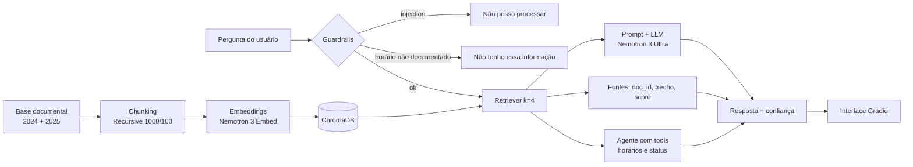

# Assistente de Mobilidade — Linha 714 (Vai-e-Vem)

Projeto de **Generative Systems (GS 2026.2)** que implementa um pipeline **RAG** sobre a base documental da Linha 714 de transporte público, com interface de chat em Gradio, agente com ferramentas, guardrails de segurança e avaliação com RAGAS.

**Tema:** Mobilidade  
**Turma/Sala:** 1CCPI  
**Grupo:** Grupo X

## Integrantes

| Integrante | RM |
|---|---|
| Eric dos Santos Mendes da Silva | 569528 |
| Rafael Côrtes Lins | 570588 |
| Tom Stringasci Albuquerque Coelho Morais | 568844 |

## Descrição do projeto

O notebook `GS2026_2_1CCPI_GrupoX.ipynb` constrói um assistente capaz de responder perguntas sobre a Linha 714 usando dois documentos oficiais:

- `linha_714_itinerario_2024.txt` — itinerário, horários, tarifas e pontos (2024).
- `portaria_atualizacao_2025.txt` — interdição do ponto da Rua das Flores e mudança da gratuidade (Portaria 047/2025).

O sistema:

1. Carrega e divide os documentos em chunks com `RecursiveCharacterTextSplitter` (1000/100).
2. Gera embeddings com `nvidia/nemotron-3-embed-1b:free` (OpenRouter) e indexa no ChromaDB.
3. Recupera os chunks mais relevantes (`k=4`) e gera respostas com `nvidia/nemotron-3-ultra-550b-a55b:free` (OpenRouter), citando `doc_id`.
4. Oferece um agente com ferramentas (`calcular_proximo_horario` e `verificar_status_ponto`).
5. Expõe uma interface Gradio com chat, fontes consultadas e nível de confiança.
6. Aplica três guardrails: validação de faixa etária, proteção contra alucinação de horários e sanitização contra prompt injection.
7. Avalia o pipeline com RAGAS (avaliador `nvidia/nemotron-3-ultra-550b-a55b:free` + embeddings `nvidia/nemotron-3-embed-1b:free`, via OpenRouter) e exporta `3_avaliacao_ragas.json`.

## Diagrama do pipeline



## Prints das telas

> Substitua os arquivos abaixo pelos prints reais após executar a interface Gradio (`demo.launch()`).

### Chat com resposta e confiança


### Painel de fontes consultadas


### Avaliação RAGAS


## Instruções de execução

1. Abra `GS2026_2_1CCPI_GrupoX.ipynb` no **Google Colab** (Python 3.10+).
2. Execute a célula de setup e instale as dependências:
   ```bash
   !pip install -q chromadb langchain langchain-core langchain-classic langchain-community \
     langchain-text-splitters langchain-chroma langchain-openai \
     gradio ragas datasets openai python-dotenv
   ```
3. Envie a pasta `2_base_documental` para `/content` (ou monte o Google Drive).
4. Em **Colab > Secrets**, configure `OPENROUTER_API_KEY` com a chave do OpenRouter (com **Notebook access** ligado).
5. Execute as seções **0 a 7** em ordem. Os embeddings (seção 2), a geração (seção 3) e a avaliação RAGAS (seção 7) usam a API do OpenRouter.
6. A interface Gradio sobe na seção 6.3:
   ```python
   demo.launch(share=True)
   ```
7. A avaliação da seção 7 gera o arquivo:
   ```
   3_avaliacao_ragas.json
   ```

### Requisitos

- Conta e chave no OpenRouter (`OPENROUTER_API_KEY`).
- Modelos gratuitos: `nvidia/nemotron-3-ultra-550b-a55b:free` (geração/avaliação) e `nvidia/nemotron-3-embed-1b:free` (embeddings).

## Link do vídeo

> Adicione aqui o link da demonstração.

[Vídeo de demonstração](https://youtu.be/SEU_LINK_AQUI)